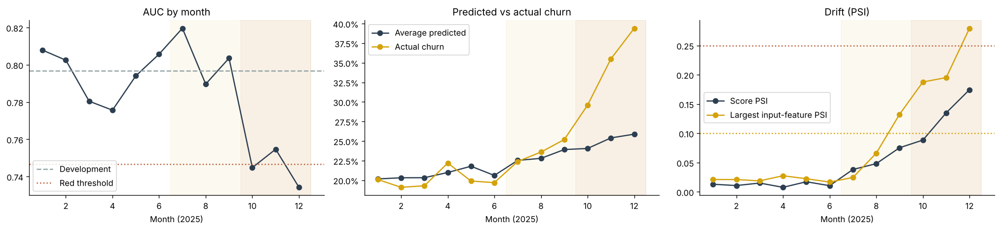
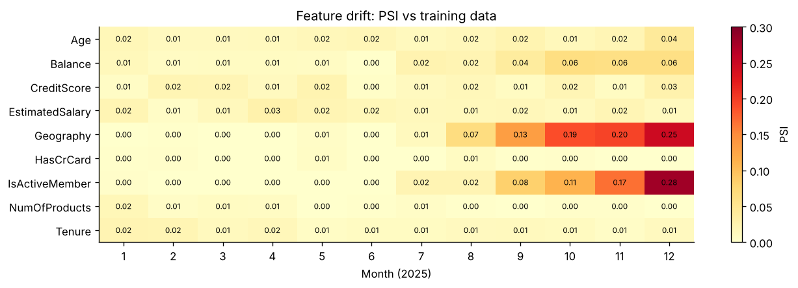

# Bank Churn Model with Monitoring (Python + Power BI)

Building a customer churn model **and owning it after deployment**: a documented fair-lending decision, a champion chosen by a rule fixed in advance,
calibration and fairness checks, a retention business case, and a **monthly monitoring framework** with green/amber/red thresholds.
A simulated production year with population drift and a market shock feeds an **interactive Power BI monitoring report**.

**▶ Power BI report: [PDF export](powerbi/bank_churn_monitoring.pdf)** · [Notebook](notebooks/bank_churn_model_monitoring.ipynb) · [Model card](MODEL_CARD.md) · [Power BI build guide](powerbi/POWERBI_BUILD_GUIDE.md)



## Business problem

About 1 in 5 of the bank's customers leave. Keeping a customer costs far less than winning a new one, so the retention team wants to know **whom to contact** and **what a campaign is worth**.
A churn model answers that on the day it's built; whether it still answers it six months later is the model owner's job.

## Data

[Churn Modelling](https://www.kaggle.com/datasets/shrutimechlearn/churn-modelling) (Kaggle): 10,000 customers of a European retail bank (France, Germany, Spain), 20.4% of whom left.
Amounts are treated as euros. No missing values or duplicates.

## Approach

1. **Exploratory analysis:** churn is 28% with one product, 8% with two, and 83–100% with three or four, so products are treated as categories. Inactive customers churn nearly twice as often; Germany's rate is double France's and Spain's.
2. **Fair-lending decision:** gender and age are excluded (protected grounds under the Canadian Human Rights Act). Measured cost: CV AUC **0.858 → 0.806**, all of it from age.
3. **Model comparison:** logistic regression, decision tree, random forest and gradient boosting in identical pipelines, chosen by 5-fold CV AUC → **gradient boosting**.
4. **Evaluation:** test AUC **0.797**; top-decile precision **66.5%** (3.3× the average); predicted churn 20.5% vs actual 20.3%, well calibrated across deciles.
5. **Retention economics:** contact customers above the break-even probability, cost ÷ (success rate × value) = **16.7%**. On the test set: 45% of customers contacted, 78% of churners reached, €25,550 realised vs €11,050 for contacting everyone.
6. **Fairness check:** outcomes compared by gender, age band and country.
7. **Monitoring design:** five monthly checks with amber/red thresholds (AUC drop, score PSI, calibration gap, top-decile precision, largest feature PSI).
8. **Simulated production year:** 1,000 customers a month for 2025, with population drift from July and a competitor event from October.
9. **Delivery:** eight tables exported for Power BI, plus a theme, DAX measures (including What-if parameters) and a page-by-page build guide.

## What monitoring caught

| Months | Status | What happened | Response |
|---|---|---|---|
| Jan–Aug | Green | Normal noise: monthly AUC 0.776–0.820 | None |
| Sep | **Amber** | Country mix drifted (Geography PSI 0.13); performance still fine | Investigate the cause with the business |
| Oct | **Red** | Competitor savings account: actual churn 5.5 pts above prediction, AUC 0.745 | Alert model risk; recalibrate; start retraining |
| Nov–Dec | Red | Gap 10.1 then 13.5 pts; score PSI amber; IsActiveMember PSI 0.28 | Retrain, revalidate, redeploy through governance |



## Key findings

- **Feature drift warned first.** Geography crossed the amber line in September, two months before the model's score distribution did.
- **Drift and performance tell different stories.** The October event changed customer *behaviour*, not the mix, so score PSI barely moved while calibration and AUC failed. Monitoring needs both.
- **One metric isn't enough.** Top-decile precision stayed green, and even rose, because more customers were leaving overall.
- **Broken calibration breaks the business case.** In December the model's expected campaign value was €18.9K against €30.4K realised, and contacting everyone would have done better.
- **Removing protected columns doesn't equalise errors.** The model under-predicts churn for women (21% vs 25% on the test set) and most of all for customers in their 50s (28% vs 58%). Surfaced as an open decision for the business and compliance.

## Power BI report

Built from `powerbi/data/` using the [build guide](powerbi/POWERBI_BUILD_GUIDE.md).

| Page | What it shows |
|---|---|
| Model health | Overall status for the selected month; a check × month status grid |
| Performance | AUC against development and thresholds; predicted vs actual churn; calibration gap; top-decile precision |
| Drift | Score and feature PSI with thresholds; feature drift heatmap; risk-band mix by month |
| Fairness | Predicted vs actual churn by gender, age band or country |
| Retention planner | What-if sliders for offer cost, success rate and customer value; whom to contact and what it's worth |
| Model card | Model comparison, thresholds and key decisions |

<!-- After building the report, add your screenshots here, e.g.:


-->

**Data model:** a star schema. `months` is the shared date dimension for the five monthly and customer-level tables; `monitoring_status` also links to `thresholds`.

## Limitations

- One bank, one undated snapshot; the production year is simulated to show how monitoring responds.
- The model predicts *who will leave*, not *who the offer will keep*; an uplift model would need a randomised campaign.
- Offer cost, success rate and customer value are illustrative.

## Project structure

```
├── notebooks/
│   └── bank_churn_model_monitoring.ipynb   # Full analysis, commented step by step
├── src/churn_model.py          # Same logic as a module; regenerates the Power BI tables
├── MODEL_CARD.md               # Model documentation: use, data, decisions, performance, fairness, monitoring
├── powerbi/
│   ├── data/                   # Tables for Power BI (written by the notebook)
│   ├── DataKritii_theme.json   # Report theme
│   ├── measures.dax            # All DAX measures, with formats
│   └── POWERBI_BUILD_GUIDE.md  # Page-by-page build instructions
├── tests/test_churn_model.py   # Automated checks
├── data/Churn_Modelling.csv
├── reports/figures/
└── requirements.txt
```

## How to run

```bash
git clone https://github.com/DataKritii/bank-churn-model-monitoring.git
cd bank-churn-model-monitoring
pip install -r requirements.txt

jupyter notebook                 # the analysis notebook (writes powerbi/data/)
python -m src.churn_model        # or regenerate the Power BI tables without the notebook
pytest tests/                    # the automated tests
```

## Tech stack

Python · pandas · scikit-learn · matplotlib · Power BI (DAX, What-if parameters, star schema) · pytest
